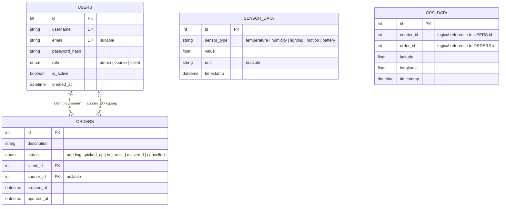

# Схема базы данных Smart Logistics

## Кратко об архитектуре

Сейчас приложение использует два отдельных файла SQLite и два независимых SQLAlchemy engine:

- `backend/business.db` — бизнес-данные: учётные записи и заказы.
- `backend/telemetry.db` — временные ряды показаний датчиков и GPS.

Это разделение отделяет транзакционные данные от часто поступающей телеметрии. Пока оба хранилища — SQLite, а не специализированная Time-Series DB. Позже `telemetry.db` можно заменить на TimescaleDB, InfluxDB или другое хранилище телеметрии отдельно от бизнес-БД.

## ER-диаграмма



`USERS` и `ORDERS` находятся в `business.db`. Таблицы `SENSOR_DATA` и `GPS_DATA` находятся в `telemetry.db`; диаграмма показывает все таблицы приложения, но внешние ключи соединяют только таблицы в бизнес-БД.

## Реляционная схема по таблицам

### `business.db`

#### `users`

| Поле | Тип SQLite | Ограничения | Назначение |
|---|---|---|---|
| `id` | `INTEGER` | Primary key, индекс | Внутренний идентификатор |
| `username` | `VARCHAR(64)` | `NOT NULL`, `UNIQUE`, индекс | Имя для входа |
| `email` | `VARCHAR(254)` | `NULL`, `UNIQUE` | Email пользователя |
| `password_hash` | `VARCHAR(255)` | `NOT NULL` | Хеш пароля, не открытый пароль |
| `role` | `VARCHAR(7)` | `NOT NULL`, индекс; `admin`, `courier` или `client` | Роль для RBAC |
| `is_active` | `BOOLEAN` | `NOT NULL`, по умолчанию `true` | Разрешён ли вход |
| `created_at` | `DATETIME` | `NOT NULL` | Время создания UTC |

#### `orders`

| Поле | Тип SQLite | Ограничения | Назначение |
|---|---|---|---|
| `id` | `INTEGER` | Primary key, индекс | Идентификатор заказа |
| `description` | `VARCHAR(500)` | `NOT NULL` | Описание доставки |
| `status` | `VARCHAR(10)` | `NOT NULL`, индекс; `pending`, `picked_up`, `in_transit`, `delivered`, `cancelled` | Текущий статус |
| `client_id` | `INTEGER` | `NOT NULL`, FK → `users.id`, индекс, `ON DELETE RESTRICT` | Владелец заказа |
| `courier_id` | `INTEGER` | `NULL`, FK → `users.id`, индекс, `ON DELETE SET NULL` | Назначенный курьер |
| `created_at` | `DATETIME` | `NOT NULL` | Время создания UTC |
| `updated_at` | `DATETIME` | `NOT NULL` | Время последнего изменения UTC |

Связи: один клиент может иметь много заказов; курьер может быть назначен на несколько заказов; заказ может временно оставаться без курьера.

### `telemetry.db`

#### `sensor_data`

| Поле | Тип SQLite | Ограничения | Назначение |
|---|---|---|---|
| `id` | `INTEGER` | Primary key, индекс | Идентификатор измерения |
| `sensor_type` | `VARCHAR(32)` | `NOT NULL`, индекс | Тип: `temperature`, `humidity`, `lighting`, `motion`, `battery` |
| `value` | `FLOAT` | `NOT NULL` | Числовое значение |
| `unit` | `VARCHAR(16)` | `NULL` | Например, `C`, `%`, `bool` |
| `timestamp` | `DATETIME` | `NOT NULL`, индекс | Время измерения UTC |

Для `lighting` и `motion` симулятор отправляет `0` или `1`; освещение меняется вместе с моковым датчиком движения. Для `battery` значение — заряд аккумулятора в процентах.

Симулятор удерживает температуру около 22,4 °C с небольшими изменениями (не более 0,03 °C за минутное измерение). Заряд батареи отправляется раз в 10 секунд и в демонстрационном ускоренном режиме уменьшается на 1 процентный пункт за измерение. При достижении 17% записывается значение 17%, затем сразу значение 100% — имитация замены аккумулятора.

#### `gps_data`

| Поле | Тип SQLite | Ограничения | Назначение |
|---|---|---|---|
| `id` | `INTEGER` | Primary key, индекс | Идентификатор координаты |
| `courier_id` | `INTEGER` | `NOT NULL`, индекс | Логическая ссылка на `business.users.id` |
| `order_id` | `INTEGER` | `NOT NULL`, индекс | Логическая ссылка на `business.orders.id` |
| `latitude` | `FLOAT` | `NOT NULL`, диапазон API `-90..90` | Широта |
| `longitude` | `FLOAT` | `NOT NULL`, диапазон API `-180..180` | Долгота |
| `timestamp` | `DATETIME` | `NOT NULL`, индекс | Время координаты UTC |

На `courier_id` и `order_id` намеренно нет SQL foreign key: таблица GPS расположена в другом файле SQLite, и внешний ключ не может обеспечить ссылочную целостность между двумя отдельными базами. Перед приёмом координат API проверяет назначение заказа в `business.db`.

## Что делает симулятор

Скрипт [`simulator/iot_simulator.py`](../simulator/iot_simulator.py) подключается к WebSocket backend и имитирует источники данных:

- температура и влажность — случайные значения раз в 60 секунд;
- движение и освещение — значение `0` или `1` раз в 10 секунд;
- GPS курьера — небольшое случайное смещение от стартовых координат раз в 5 секунд.

Для датчиков симулятор авторизуется токеном IoT-устройства. Для GPS он входит как курьер через REST, получает JWT и подключается к GPS-каналу назначенного заказа. Сервер проверяет данные, сохраняет их в `telemetry.db`, затем рассылает подписчикам с учётом их ролей и заказа. Симулятор поддерживает запуск обоих потоков вместе или отдельно и повторно подключается после разрыва связи.

## Демонстрационные данные

Для локального создания пользователей администратора, курьера, клиента и примера активного заказа запустите в `backend`:

```powershell
python -m app.seed_demo
```

Демо-аккаунты предназначены только для локального тестирования. Не используйте их пароли в развёрнутом приложении.
